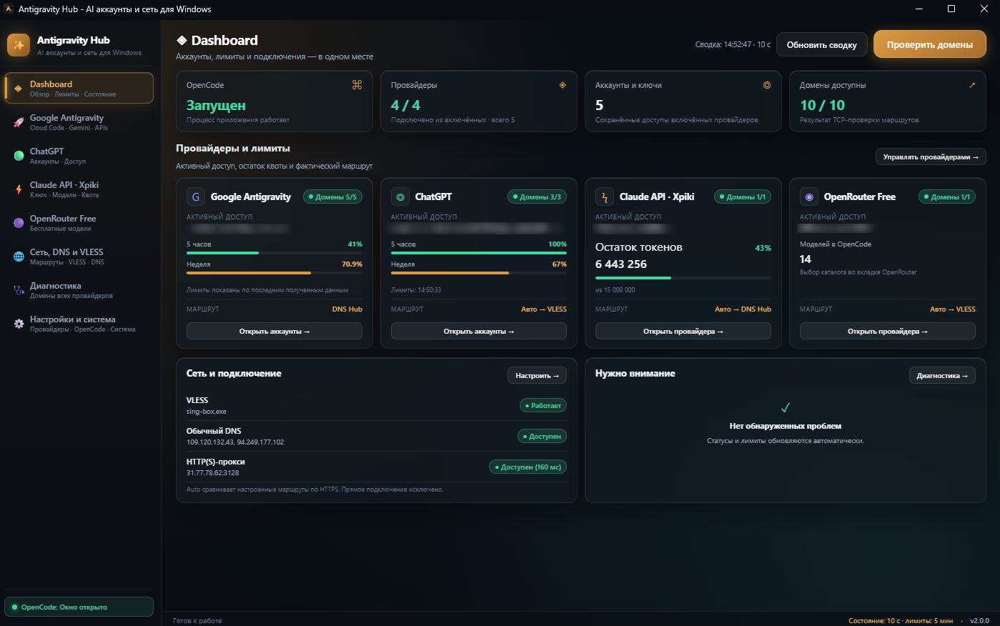

# OpenCode Antigravity Module (V2)

Универсальный шлюз-модуль и графический центр управления (**Antigravity Hub**) для [OpenCode 2.x](https://github.com/anomaly/opencode). Объединяет доступ к передовым нейросетям через несколько провайдеров, поддерживает пулы аккаунтов с авто-ротацией, веб-сессии без API-ключей, встроенное VLESS-туннелирование и раздельный мониторинг лимитов.

<p align="center">
  
</p>

---

## 🌟 Ключевые возможности

### 1. 🚀 Google Antigravity (OAuth & Multi-Account Pool)
- **Модели нового поколения:** Google Gemini 3.8 Flash, Gemini 4 Argon, Claude Sonnet 4.6 Thinking, Claude 5.5 и другие модели Cloud Code. Устаревшие и отключённые Google модели (3.1, 3.5, 3.6, 3.7) автоматически фильтруются.
- **Пул Google-аккаунтов:** Добавляйте неограниченное количество аккаунтов Google с автоматическим переключением при исчерпании квот (Rate Limit 429). Мгновенное обновление статуса аккаунтов в интерфейсе.
- **Раздельный учет лимитов:** Наглядная индикация двух типов квот:
  - 🟢 **Зеленый индикатор** — текущая 5-часовая скользящая квота (краткосрочный лимит).
  - 🟠 **Оранжевый индикатор** — недельная суммарная квота аккаунта.
- **Защита от истощения пула:** Если подключён только один Google-аккаунт, плагин интеллектуально ожидает сброса лимита до 60 секунд вместо немедленной остановки работы.
- **Интерактивная диагностика:** Встроенная проверка здоровья моделей (Model Health Checker) прямо из Hub с выявлением скрытых ошибок потоковой передачи и диагностикой маршрутов.
- **Умные патчи стабильности:**
  - Защита от бесконечного цикла повторов при ошибке 404 — немедленный возврат оригинального ответа Google.
  - Автоматическая фиксация модели именования сессий `opencode/big-pickle` (`small_model` и `agent.title.model`), предотвращающая сбои из-за недоступных моделей Gemini 3.5.
  - Патчи потоковой передачи и совместимости терминала (Gemini 3.8 / SSE / TTY).
- **Поддержка современных версий OpenCode:** Совместимость со всеми релизами линейки 2.x, включая структуру установки OpenCode 2.2.0 (`ai.opencode.desktop`).

### 2. 🟢 OpenAI / ChatGPT (Многоаккаунтный пул и вход через браузер)
- **Прямой вход в 1 клик:** Авторизация через браузер без необходимости вручную извлекать и обновлять сессионные токены.
- **Пул аккаунтов ChatGPT:** Добавление нескольких аккаунтов OpenAI с отображением email, мгновенным переключением активного профиля и синхронизацией с OpenCode.
- **Интеграция с официальным провайдером:** Запросы транслируются напрямую в OpenCode с поддержкой последних моделей GPT.

### 3. 🟠 Claude Code / Pro & Team (Подписка без API-токенов)
- **Прямой бридж веб-подписки:** Используйте возможности платной подписки Claude Pro или Claude Team в OpenCode без необходимости покупать дорогие токены Anthropic API.
- **Локальный мост (Claude Bridge):** Поднимает локальный шлюз (`http://127.0.0.1:10815`), преобразующий вызовы OpenCode в безопасные сессионные запросы `claude.ai`.
- **Вход в 1 клик и тихий рефреш:** Автоматический вход через браузер с мгновенным извлечением cookie `sessionKey` и фоновым обновлением сессии. Автоматическое закрытие окна сессии при ошибках рефреша. Также поддерживается ручной ввод токена.
- **Безопасная авторизация через VLESS:** Предупреждение перед открытием окна авторизации при выключенном VLESS для защиты от геоблокировок Cloudflare/Anthropic. Возможность запустить браузер входа через изолированный прокси-туннель.
- **Claude Kill Switch:** Специализированный механизм блокировки запросов в случае обрыва туннеля для предотвращения утечки реального IP и бана аккаунта.
- **Интеграция с Claude Code CLI:** Быстрый запуск `claude setup-token` прямо из интерфейса Hub.

### 4. ⚡ Claude API (Xpiki Gateway)
- **Выделенный провайдер Xpiki:** Готовая интеграция со сторонним шлюзом Claude API (`api.xpiki.com`).
- **Модели:** `claude-opus-5`, `claude-opus-4-8`, `claude-opus-4-7`, `claude-sonnet-5`, `claude-sonnet-4-6`, `claude-haiku-4-5`, `claude-fable-5`.
- **Живая карточка квот:** Отображение баланса, доступных кредитов, остатка запросов и времени до ежедневного сброса лимитов в реальном времени.
- **Конфигурация в 1 клик:** Мгновенное добавление провайдера и выбранных моделей в конфигурацию OpenCode.

### 5. 🟣 OpenRouter Free
- **Бесплатные модели:** Подключение открытых бесплатных моделей из каталога OpenRouter по вашему бесплатному API-ключу.
- **Выборочный каталог:** Выбирайте только нужные модели, исключая захламление списка в OpenCode.

### 6. 🌐 Сеть: Поканальная маршрутизация, SmartDNS и VLESS
- **Поканальная маршрутизация (Per-Provider Routing):** Раздельная настройка сетевого пути для каждого провайдера (Google, Claude, OpenAI, Xpiki). Вы можете пустить Claude через VLESS, Google через встроенный SmartDNS, а остальные запросы — напрямую.
- **Встроенный Google SmartDNS (автономно, без стороннего ПО):** Встроенный перенос TLS через DoH-резолвер для доменов Google Cloud Code без необходимости использовать сторонние утилиты (AG Unlocker и др.) и без установки локальных корневых сертификатов или перехвата трафика. Сворачиваемая панель настроек и интерактивная диагностика маршрутов.
- **Встроенный туннель VLESS:** Поддержка ядер Xray-core и sing-box. Автоматическая загрузка ядер с несколькими зеркалами и защитой от падений.
- **Изоляция сетевых портов:** Использование выделенных локальных портов (`20809` HTTP, `20808` SOCKS5 по умолчанию; также поддерживаются `10879`/`10878`) для полного исключения конфликтов с браузерными расширениями и другими VPN-клиентами.
- **Безопасное управление ядрами:** Hub контролирует только собственный дочерний процесс прокси и не завершает сторонние системные процессы `sing-box` или `Xray`.
- **Безопасный DNS и готовые Smart DNS пресеты:** Тестирование и быстрое переключение защищённых серверов в 1 клик:
  - **DNS-AI (`dns-ai.ru`)** — специализированный Smart DNS для работы с AI в РФ и РБ (`https://dns.dns-ai.ru/dns-query`, `194.87.196.13`);
  - **MagicDNS (`magicdns.ru`)** — высокоскоростной Smart DNS для ИИ к Gemini, ChatGPT и Claude (`https://dns.magicdns.ru/dns-query`, `109.120.132.43`);
  - **Bezmezhau (`bezmezhau.com`)**;
  - **Cloudflare**, **Google**, **Quad9**.
- **Прямые обновления Hub:** Проверка и скачивание обновлений модуля из GitHub всегда производятся напрямую через системную сеть, исключая зависания при нестабильном прокси.

### 7. 🎨 Графический менеджер Antigravity Hub
- **Дизайн Frosted Glass (Вариант №3):** Премиальный тёмный интерфейс с аппаратным матовым стеклом (`backdrop-filter: blur(40px)`), глубоким графитовым фоном и янтарно-бирюзовыми неоновыми ореолами (aurora glow), работающий на нативном движке WebView2 (Edge Chromium).
- **Компактный адаптивный Dashboard:** Вся ключевая информация (метрики системы, карточки провайдеров, статусы сети и внимания) оптимизирована и полностью помещается в окно без вертикальной прокрутки.
- **Полноценная индикация лимитов:**
  - 🟢 **Gemini (5 часов)** — изумрудный индикатор скользящей квоты.
  - 🟠 **Gemini (Неделя)** — контрастный янтарный индикатор недельного лимита.
  - 🔷 **Claude Opus / Sonnet в Google Antigravity** — раздельный мониторинг квот для моделей Claude (Opus / Sonnet) с бирюзовой и фиолетовой подсветкой.
  - ⚡ **Claude API (Xpiki)** — шкала прогресса и процент остатка токенов прямо на дашборде и во вкладке провайдера.
- **Пул HTTP(S)-прокси с авторотацией (Failover):** Поддержка добавления нескольких внешних прокси в общий пул с открытым отображением адреса, автоматической проверкой доступности, измерением пинга и мгновенным переключением на следующий узел при сбое.
- **Интеграция с Windows:**
  - Фирменная тёмная иконка Antigravity Hub на Рабочем столе и в панели задач (без дефолтной иконки Python).
  - Тёмный заголовок окна под цвет интерфейса (без белой системной полосы).
  - Сворачивание в системный трей вместо выхода при клике на крестик окна (с настройкой поведения в меню).
  - Встроенное обновление с GitHub в один клик с защитой от лимитов API.
- **Резервное копирование и перенос на другой ПК (Backup & Restore):** Быстрый экспорт и импорт всех настроенных аккаунтов (Google, ChatGPT, Claude, Xpiki, OpenRouter), API-ключей, пула прокси и сетевых маршрутов в единый JSON-файл для бесшовного переноса окружения на новый компьютер в один клик.

---

## 🛠 Как это работает

```
  ┌─────────────────────────────────────────────────────────┐
  │                       OpenCode                          │
  └───────────────────────────┬─────────────────────────────┘
                              │
                    Плагин Antigravity V2
                              │
        ┌─────────────────────┼─────────────────────┐
        ▼                     ▼                     ▼
┌──────────────┐      ┌──────────────┐      ┌──────────────┐
│Google/OpenAI │      │    Claude    │      │   Сторонние  │
│ Antigravity  │      │ Subscription │      │     API      │
│ Account Pool │      │ Bridge:10815 │      │   (Xpiki /   │
│      │       │      │              │      │  OpenRouter) │
└──────┼───────┘      └───────┬──────┘      └──────┬───────┘
       ▼                      │                    │
┌──────────────┐              │                    │
│Hub Dispatcher│              │                    │
│ 127.0.0.1:   │              │                    │
│    10880     │              │                    │
└──────┬───────┘              │                    │
       │                      │                    │
       └──────────────────────┼────────────────────┘
                              ▼
                ┌───────────────────────────┐
                │   Поканальная маршрутизация│
                │(VLESS / SmartDNS / Direct)│
                └───────────────────────────┘
```

1. **Плагин OpenCode (`plugin/dist/`):** Интегрируется в среду выполнения OpenCode, перехватывает запросы к выбранным моделям и направляет их через соответствующий бэкенд. Включает патчи против зацикливания при ошибках 404, поддержку TTY/SSE и авто-фиксацию модели заголовков `opencode/big-pickle`.
2. **Ротация аккаунтов Google:** При получении статуса `429 Too Many Requests` плагин мгновенно переключает рабочий контекст на следующий свободный аккаунт из пула `antigravity.json`. Если подключён один аккаунт — интеллектуально ожидает восстановления квоты (до 60 секунд).
3. **Диспетчер Hub (`127.0.0.1:10880`) и Google SmartDNS:** Запросы к Google Cloud Code API транслируются через локальный диспетчер Hub. Вы можете настроить сетевой путь для Google независимо от остальных сервисов: напрямую, через туннель VLESS, внешний HTTP-прокси или встроенный **Google SmartDNS** (автономный перенос TLS через DoH без стороннего софта вроде AG Unlocker и без необходимости ставить сертификаты перехвата).
4. **Claude Subscription Bridge:** Для пользователей Claude Pro/Team поднимается локальный сервер на порту `10815`. Он принимает стандартные сообщения OpenAI/Anthropic формата и перенаправляет их в веб-сессию Claude от имени вашего авторизованного браузера. Для безопасности сессии поддерживается Claude Kill Switch и предупреждение при запуске без VLESS.
5. **VLESS & Сетевая изоляция:** Встроенный менеджер контролирует только собственный изолированный дочерний процесс Xray/sing-box и использует выделенные порты (`20809` HTTP, `20808` SOCKS5 / `10879`, `10878`), что исключает конфликты с браузерными расширениями и другими VPN-клиентами. Сторонние системные процессы ядра никогда не завершаются. Проверка и скачивание обновлений Hub с GitHub выполняются всегда напрямую через системную сеть в обход прокси.

---

## 📦 Установка

### Windows — быстрая установка одной командой

Откройте **PowerShell** (от имени обычного пользователя) и выполните:

```powershell
(irm https://raw.githubusercontent.com/ZLoBNbIY/Opencode-antigravity-module/V2/install.ps1).Trim([char]65279) | iex
```

Установщик:
- **Интеллектуальная проверка Python 3:** Функция глубокого сканирования `Get-PythonEnvironment` отсекает фиктивную заглушку Microsoft Store (`WindowsApps\python.exe`, вызывающую ошибку 9009), опрашивает лаунчер `py`, проверяет стандартные каталоги (`Programs\Python`, `Program Files`, `C:\Python3*`) и при необходимости временно прописывает путь к Python в текущую сессию.
- **Диагностика и рекомендации:** Если Python не установлен, установщик не падает, а выводит понятное сообщение с прямой ссылкой на загрузку (`https://www.python.org/downloads/`), командой для терминала `winget install Python.Python.3.12` и напоминанием включить галочку **«Add python.exe to PATH»**.
- **Автоматическая проверка Node.js:** Проверяет наличие Node.js (требуется версия 20+) и при необходимости предлагает или выполняет установку актуальной LTS-версии.
- **Конфигурация OpenCode:** Поддерживает все актуальные версии редактора, включая OpenCode 2.2.0 (`ai.opencode.desktop`), разворачивает конфиги `opencode.json` и `antigravity.json`.
- **Ярлык запуска:** Создает удобный ярлык на рабочем столе **Antigravity Hub**.

### Windows — из клонированного репозитория

```powershell
git clone -b V2 https://github.com/ZLoBNbIY/Opencode-antigravity-module.git
cd Opencode-antigravity-module
powershell -ExecutionPolicy Bypass -File .\install.ps1
```

*(Также доступен скрипт `install.bat` с автоматическим переходом на PowerShell и валидацией окружения).*

### Linux / macOS

```bash
git clone -b V2 https://github.com/ZLoBNbIY/Opencode-antigravity-module.git
cd Opencode-antigravity-module
chmod +x install.sh
./install.sh
```

---

## 🚀 Быстрый старт

1. **Запустите менеджер:**
   - На Windows: запустите ярлык **Antigravity Hub** с рабочего стола или файл `Запуск_Менеджера.bat`.
   - В терминале: `python gui-manager/antigravity_manager.pyw`.
2. **Подключите провайдеров:**
   - **Google Antigravity:** Нажмите **«+ Добавить Google-аккаунт»** и авторизуйтесь в браузере. Для устойчивости добавьте 2 или более аккаунтов.
   - **OpenAI / ChatGPT:** Нажмите **«+ Добавить OpenAI»** во вкладке ChatGPT для авторизации через браузер.
   - **Claude Pro / Team:** Откройте вкладку Claude, нажмите **«Войти через браузер»** (при необходимости включите галочку *«Использовать VLESS-браузер»*).
   - **Xpiki / OpenRouter:** Вставьте API-ключ в соответствующей вкладке и нажмите **«Добавить в OpenCode»**.
3. **Запустите OpenCode:**
   - Нажмите кнопку **«🔄 Перезапуск OpenCode»** внизу боковой панели Hub.
   - В интерфейсе OpenCode откройте выбор моделей: включите нужного провайдера (**Google**, **ChatGPT**, **Claude**, **Xpiki**, **OpenRouter Free**) и выберите желаемую модель.

---

## 📖 Подробные инструкции по настройке провайдеров

### 1. Google Antigravity
1. В Antigravity Hub нажмите **«+ Добавить Google-аккаунт»** (или выполните в консоли `node plugin/dist/cli.js login`).
2. В открывшемся окне браузера подтвердите вход в Google-аккаунт.
3. Аккаунт появится в списке Hub с двумя полосами квот:
   - **Зелёная** — 5-часовой лимит (обновляется скользящим окном);
   - **Оранжевая** — недельный лимит.
4. Для максимальной надежности добавьте 2–3 аккаунта — плагин будет автоматически ротировать их при наступлении лимитов (Rate Limit 429).
5. При нажатии кнопки **«Проверить модели» (Health Check)** запускается проверка доступности текущих моделей в реальном времени.

### 2. OpenAI / ChatGPT (Аккаунты ChatGPT)
1. В Antigravity Hub перейдите на вкладку **ChatGPT (OpenAI)**.
2. Нажмите **«+ Добавить OpenAI»** — откроется браузер для авторизации в вашем аккаунте OpenAI (поток token sharing OpenCode: Hub запрашивает скоуп `chatgpt.tokens.use.direct`).
3. После успешного входа аккаунт появится в карточках с email, лимитами и списком доступных моделей — модели аккаунта (`GET api.openai.com/v1/models`) перечитываются автоматически при добавлении, активации и обновлении лимитов.
4. Вы можете подключать несколько аккаунтов ChatGPT и в 1 клик переключать активный профиль для OpenCode (кнопка **«⭐ Сделать активным»**), либо удалить аккаунт кнопкой **«🗑»** (активный аккаунт заменяется следующим из пула актуальным).
5. В OpenCode при активном ChatGPT-аккаунте список моделей формируется автоматически (только модели, доступные по подписке); старые аккаунты, добавленные до этого обновления, нужно удалить и подключить заново.

### 3. Claude Pro / Team (Подписка claude.ai без API-токенов)
1. Если вы находитесь в регионе с блокировками Anthropic / Cloudflare:
   - Вставьте вашу ссылку `vless://` во вкладке **🌐 Сеть, DNS & VLESS** и включите туннель.
   - Включите переключатель **«Использовать VLESS-браузер»** на вкладке Claude.
2. Нажмите **«Войти через браузер»**. Откроется окно входа `claude.ai`.
3. После успешного входа Hub автоматически перехватит `sessionKey`, закроет окно и запустит локальный Claude Bridge (`10815`).
4. Для защиты от случайных разрывов туннеля включите **Claude Kill Switch** — он мгновенно заблокирует запросы в случае потери соединения с прокси.
5. Выберите нужные модели (Opus 5, Sonnet 5, Sonnet 4.6, Claude 3.7 Sonnet Thinking) и нажмите **«Добавить выбранные в OpenCode»**.

### 4. Claude API (Xpiki Gateway)
1. Получите API-ключ на шлюзе [Xpiki](https://api.xpiki.com).
2. В Antigravity Hub откройте вкладку **Claude API (Xpiki)** и вставьте ключ.
3. Hub отобразит статус ключа, баланс, лимиты запросов и таймер суточного сброса квоты.
4. Отметьте флажками нужные модели и нажмите **«Добавить выбранные в OpenCode»**.
5. Модели станут доступны в OpenCode в провайдере `xpiki/` (например, `xpiki/claude-opus-5`).

### 5. OpenRouter Free
1. Зарегистрируйтесь на [openrouter.ai](https://openrouter.ai/) и сгенерируйте бесплатный ключ на странице [API Keys](https://openrouter.ai/settings/keys).
2. Во вкладке **OpenRouter Free** вставьте ключ и нажмите **«Проверить ключ и загрузить модели»**.
3. Отметьте интересующие бесплатные модели и добавьте их в OpenCode.
4. При этом встроенный каталог платных моделей OpenRouter временно скрывается, оставляя только выбранные бесплатные модели.

### 6. Сетевые маршруты и Google SmartDNS
1. Откройте вкладку **🌐 Сеть, DNS & VLESS**.
2. В блоке **«Сетевая маршрутизация провайдеров»** вы можете выбрать индивидуальный путь для каждого сервиса:
   - **Google Antigravity:** «Напрямую», «VLESS-туннель», «Внешний HTTP-прокси» или «Google SmartDNS».
   - **Claude (Subscription):** «VLESS-туннель» (рекомендуется при блокировках), «Напрямую» или «Внешний прокси».
   - **OpenAI / Сторонние API:** настраивается независимо.
3. **Встроенный Google SmartDNS:**
   - Раскройте секцию *«Эксперимент: Google SmartDNS»* и включите тумблер.
   - SmartDNS переносит сквозной TLS-поток через DoH-резолвер только для целевых доменов Cloud Code (`cloudcode-pa.googleapis.com` и `daily-cloudcode-pa.googleapis.com`).
   - Для работы **не требуются** сторонние программы (AG Unlocker и др.), установка локальных сертификатов или модификация системных правил NRPT.
   - Для проверки нажмите **«Диагностика маршрутов Google»** — Hub протестирует доступность всех эндпоинтов и выведет подробный отчет.

---

## ⚠️ Ограничения и важные нюансы

| Компонент | Ограничение / Особенность | Рекомендация |
|---|---|---|
| **Python в Windows** | Заглушка `WindowsApps\python.exe` не является интерпретатором и завершается ошибкой при попытке запуска хаба. | Устанавливайте Python 3 (3.10–3.12) с сайта [python.org](https://www.python.org/downloads/) с обязательной галочкой **«Add python.exe to PATH»** или командой `winget install Python.Python.3.12`. |
| **Google Antigravity** | Квоты делятся на 5-часовые скользящие и недельные. Доступность экспериментальных моделей (Claude 5.5, Gemini 4 Argon) контролируется серверами Google. | Подключайте 2–3 аккаунта для непрерывной работы. При одном аккаунте подождите до 60 секунд при получении Rate Limit. |
| **Google SmartDNS** | Заменяет собой сторонние утилиты разблокировки (AG Unlocker) и направляет запросы Cloud Code через защищенный DoH-транспорт. | Не требует сторонних фоновых служб и сертификатов. Проверяйте доступность через кнопку «Диагностика маршрутов Google». |
| **Claude Pro / Team Bridge** | Доступ предоставляется через сессионные куки `claude.ai`. Сессия зависит от проверок Cloudflare и политик Anthropic. | Для входа из регионов с блокировками используйте авторизацию через **VLESS-браузер** и активируйте **Claude Kill Switch**. Не злоупотребляйте частотой параллельных запросов во избежание блокировки веб-сессии. |
| **Xpiki (Claude API)** | Лимиты запросов и доступность моделей регулируются балансом и условиями стороннего шлюза. | Следите за индикатором баланса и карточкой квот в Hub. |
| **OpenRouter Free** | Бесплатные модели могут быть перегружены, иметь задержки или ограничения на вызов функций (Tool-calling) и зрение. | Для чисто текстовых моделей создавайте новый диалог без картинок в истории. |
| **VLESS & Сеть** | Используются изолированные порты (`20809` HTTP, `20808` SOCKS5), чтобы не конфликтовать с системными VPN и браузерными расширениями. | При включённом VLESS системные DNS-настройки переопределяются DNS-маршрутизацией самого туннеля. Обновления Hub из GitHub скачиваются всегда напрямую. |
| **Версия OpenCode** | Модуль спроектирован специально для архитектуры **OpenCode 2.x** (включая 2.2.0+). | Для старых версий OpenCode 1.x используйте архивную ветку `main`. |

---

## 🔒 Безопасность и хранение данных

- Конфигурации и ключи хранятся локально в директории `~/.config/opencode/` (в Windows: `%USERPROFILE%\.config\opencode\`).
- Токены доступа и сессионные ключи шифруются средствами ОС (Windows DPAPI / локальные криптографические ключи).
- Служебный интерфейс диагностики (`health-token`) передает учетные данные через защищённый IPC-канал процесса и никогда не выводит секреты в общий журнал логов.
- **Никогда не публикуйте и не передавайте третьим лицам файлы `antigravity.json`, `claude_accounts.json` и `xpiki.json`!**

---

## 📄 Лицензия

Проект распространяется под лицензией [MIT](LICENSE). Сторонние утилиты и ядра (Xray-core, sing-box) распространяются под собственными лицензиями их авторов.
