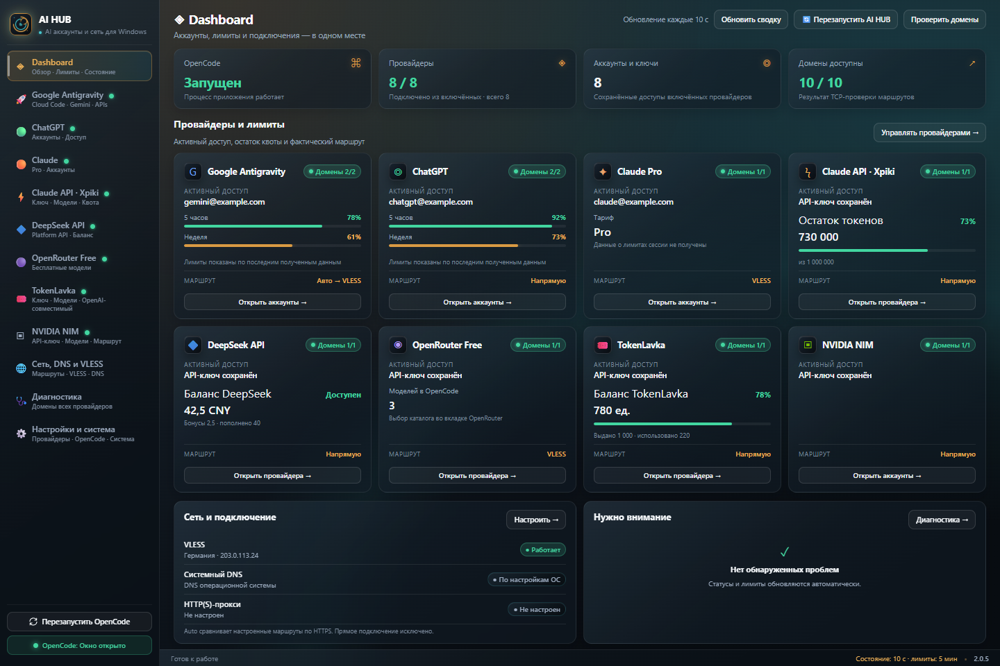

# AI HUB для OpenCode 2.x

AI HUB — приложение для Windows, в котором можно подключать AI-провайдеров к OpenCode, переключать аккаунты, смотреть лимиты и проверять сетевые маршруты.



*Актуальный интерфейс с демонстрационными данными.*

## Установка

**Windows 10/11 x64:** скачайте `AntigravityHub-Setup-x64.exe` со страницы [последнего релиза](https://github.com/ZLoBNbIY/Opencode-antigravity-module/releases/latest). Установщик не подписан; рядом опубликован SHA‑256 для проверки файла. Git, Python и Node.js не нужны. [OpenCode 2.x](https://opencode.ai/) устанавливается отдельно.

<details>
<summary>Запуск из исходников</summary>

Понадобятся Git, Python 3.12 и Node.js 20+.

```powershell
git clone -b V2 https://github.com/ZLoBNbIY/Opencode-antigravity-module.git
cd Opencode-antigravity-module
.\install.bat
```

Сборка своего установщика: [инструкция](packaging/windows/README.md).

</details>

## Провайдеры

| Провайдер | Что доступно |
| --- | --- |
| Google Antigravity | OAuth, пул аккаунтов, переключение при исчерпании квоты, мониторинг лимитов |
| OpenAI / ChatGPT | Вход через браузер, переключение аккаунтов, синхронизация с OpenCode, лимиты подписки |
| Claude Pro / Team | Локальный мост для веб-подписки `claude.ai` |
| Xpiki | Модели Claude через API и мониторинг квоты |
| OpenRouter Free | Выбор бесплатных моделей из каталога |
| [DeepSeek](docs/deepseek.md) | API, баланс платформы и график расходов по данным OpenCode |
| [TokenLavka](docs/tokenlavka.md) | Выбор моделей шлюза и остаток баланса |
| [NVIDIA NIM](docs/nvidia-nim.md) | Подключение API-ключа и выбор моделей |

Откройте вкладку провайдера, добавьте аккаунт или ключ, затем выберите его модель в OpenCode.

## Маршрутизация

- Для провайдеров Hub маршрут выбирается отдельно: **напрямую, VLESS, DNS Hub, внешний HTTP(S)-прокси или Auto**. В Auto прямой маршрут не участвует. [Подробнее](docs/auto-routing.md).
- **Встроенные модели OpenCode (`opencode/*`), каталог и провайдеры вне Hub обходят прокси Hub.** Системный VPN, DNS и отдельно настроенные прокси не меняются.
- VLESS поддерживает Xray и sing-box. На главном экране видны маршруты, доступность доменов и лимиты; проверка реальной генерации запускается вручную.
- Если обновляетесь с версии, которая назначала общий прокси, сначала перезапустите **AI HUB**, затем **OpenCode** кнопкой в Hub, чтобы обновить окружение фонового сервера.
- Патчи Antigravity, включая приведение запросов к виду нативного клиента, описаны в [docs/cloaking.md](docs/cloaking.md). Имитация стороннего клиента может нарушать условия сервиса Google и привести к блокировке аккаунта; используйте только тестовые аккаунты.

Настройки и аккаунты Hub хранятся в `%APPDATA%\AntigravityHub`. Для переноса используйте зашифрованный экспорт из приложения; не публикуйте конфиги, содержащие токены и адреса прокси.
